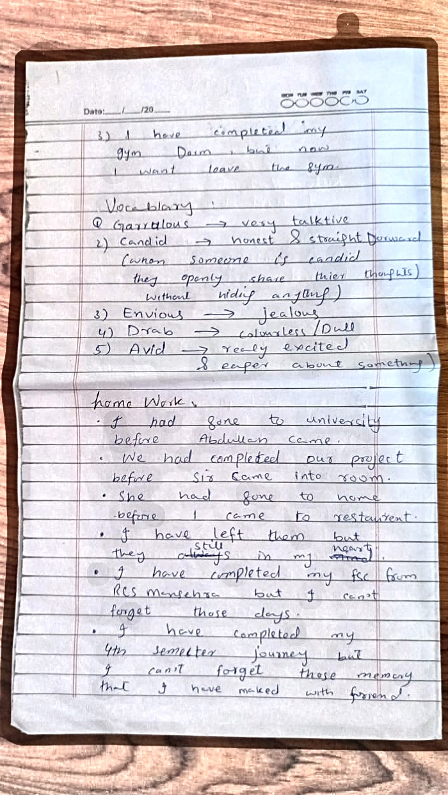
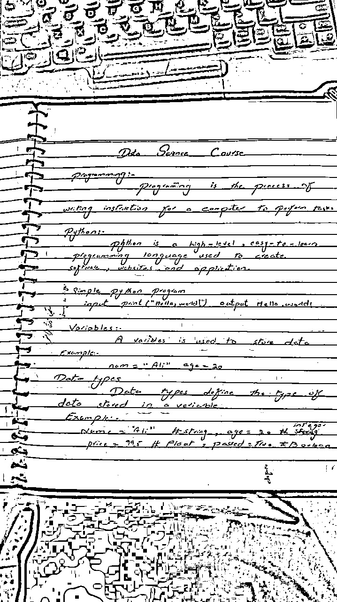
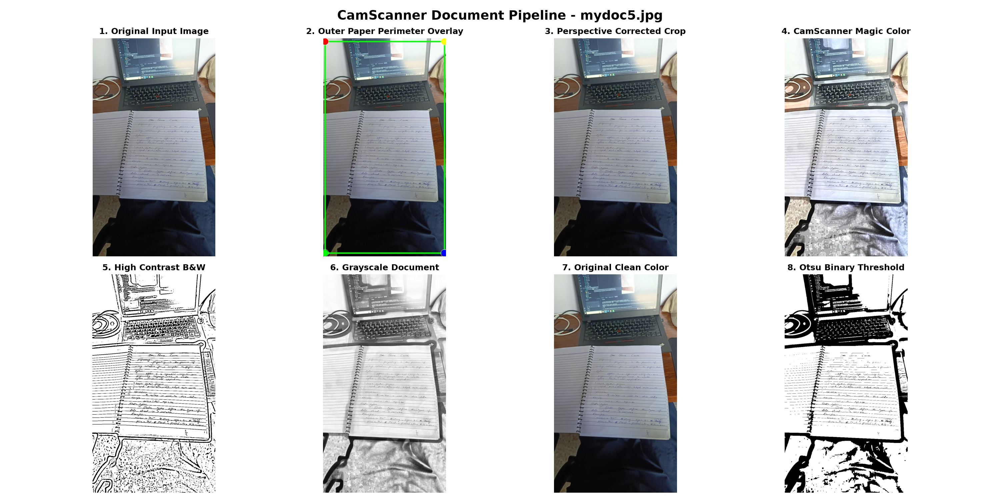

<div align="center">

<h1>
   
  &nbsp; BASIRAH DOCUMENT SCANNER PRO
</h1>


**Enterprise-Grade On-Premise Computer Vision & Data Science Processor**

<br>

<a href="https://skillicons.dev">
  
</a>

</div>

---

## 🚀 Executive Summary: A Computer Vision Perspective

**Basirah Document Scanner Pro Studio** is a robust, commercial-grade computer vision application engineered to digitize physical documents with extreme mathematical precision. Built from the ground up using **Classical Computer Vision** algorithms (OpenCV, NumPy) rather than opaque cloud-based neural networks, Basirah guarantees **100% on-device data privacy**, zero-latency processing, and fully reproducible image transformations.

As a Data Scientist and Computer Vision Engineer, I designed this architecture to bypass the limitations of cloud-dependent OCR systems. By utilizing deterministic computer vision pipelines (such as LAB color space transformations, Canny Edge Detection, and Adaptive Gaussian Thresholding), the system reliably cleans, crops, and binarizes documents locally. This makes it highly portable and deployable in strictly air-gapped or privacy-conscious enterprise environments, directly competing with proprietary mobile solutions like *CamScanner* and *Adobe Scan*.

---

## 🖼️ Application Interface & Output Gallery

The application features a sleek, intuitive frontend directly connected to the powerful FastAPI computer vision backend.

<table align="center">
  <tr>
    <td align="center"><b>UI: Dashboard & Upload Zone</b><br><sub>Modern, responsive interface for document ingestion.</sub></td>
    <td align="center"><b>UI: Interactive Quad Crop</b><br><sub>Real-time spatial mapping and manual corner dragging.</sub></td>
  </tr>
  <tr>
    <td align="center"></td>
    <td align="center"></td>
  </tr>
  <tr>
    <td align="center"><b>Output: Magic Color 2.0 Whitening</b><br><sub>Separates background illumination from foreground ink.</sub></td>
    <td align="center"><b>Output: B&W High-Contrast (OCR-Ready)</b><br><sub>Adaptive thresholding for downstream ML/OCR tasks.</sub></td>
  </tr>
  <tr>
    <td align="center"></td>
    <td align="center"></td>
  </tr>
  <tr>
    <td align="center"><b>UI: Scan Library History</b><br><sub>State history tracking with multi-page PDF batch export.</sub></td>
    <td align="center"><b>Output: Multi-Filter Comparison Grid</b><br><sub>A comprehensive look at our various enhancement modes.</sub></td>
  </tr>
  <tr>
    <td align="center"></td>
    <td align="center"></td>
  </tr>
</table>

*(Additional system screens are located in the `/screenshot/` directory)*

---

## ✨ Core Engineering Capabilities

### 🔬 Algorithmic Image Processing Pipeline
*   **4-Tier Quad Detector:** A highly resilient perimeter detection algorithm utilizing Canny edge mapping, LAB lightness space projections, and contour hull calculations to isolate the document perfectly, even on complex backgrounds.
*   **Perspective Rectification:** Automated four-point perspective warp transformation normalizes skewed and tilted camera angles into flat, top-down document matrices using affine transformations.
*   **Interactive Spatial Mapping:** An HTML5 Canvas allows users to manually drag UI quad-handles, instantly recalculating perspective transformation vectors across the backend.

### 🎨 Pro-Grade Enhancement Suite
*   **9 Algorithmic Presets:** Includes *Magic Color 2.0, Adobe Whitening, Otsu Binarization, Clean Scan, High Contrast, Grayscale*, and Original Clean.
*   **Granular Fine-Tuning:** Direct user mathematical control over Exposure (Brightness adjustments), CLAHE (Contrast Limited Adaptive Histogram Equalization), Unsharp Masking (Text Sharpness), and Color Temperature Morphology.

### 📑 Enterprise Output & Workflow
*   **Multi-Page PDF Compiler:** Select multiple scans from the built-in persistent History Library and batch-compile them into standardized A4 or US Letter PDF documents via `FPDF2`.
*   **State Management:** SQLite-free JSON state history tracking for recent scans with a grid/list UI, multi-select functionality, and preview modals.

---

## 🏗️ System Architecture

The application adopts a modern **Decoupled Monolith** architecture for maximum efficiency:

1. **Data Science Backend (`app.py`):** An asynchronous Python server powered by **FastAPI**. It exposes RESTful JSON endpoints that handle heavy I/O operations and OpenCV mathematical matrix manipulations.
2. **Frontend Client (`static/index.html`):** A lightweight, deeply optimized Single Page Application (SPA). By utilizing Vanilla JavaScript and **Tailwind CSS via CDN**, it bypasses the need for a complex Node.js/NPM build pipeline in production, allowing the FastAPI server to directly host the UI seamlessly.

---

## ⚙️ Getting Started

Follow these steps to deploy the application locally on your machine.

### 1. Clone the Repository
```bash
git clone https://github.com/sohail-ahmed-26/Documents-Scanner.git
cd Documents-Scanner
```

### 2. Configure Virtual Environment (Recommended)
```bash
python -m venv venv

# Windows:
venv\Scripts\activate

# macOS/Linux:
source venv/bin/activate
```

### 3. Install Dependencies
```bash
pip install -r requirements.txt
```

### 4. Initialize Data Science Server
```bash
python app.py
```

**Access the application:** Once the Uvicorn server successfully starts, open your web browser and navigate to: **http://127.0.0.1:8000**

---

## 👨‍💼 About the Author

**Sohail Ahmed** is a passionate Software Engineer and Computer Vision Data Scientist dedicated to building robust, algorithmic data-driven applications. With a strong foundation in Data Science and Artificial Intelligence, Sohail focuses on creating highly-optimized, privacy-first engineering solutions that rival enterprise commercial software. 

- 🌐 **Portfolio:** [sohail.devsil.com](https://sohail.devsil.com)
- 🐙 **GitHub:** [@sohail-ahmed-26](https://github.com/sohail-ahmed-26)

*I am actively seeking new opportunities in Software Engineering, Data Science, and Machine Learning. If you are a recruiter, engineering manager, or startup founder reviewing this repository, I would love to connect and discuss how my expertise in algorithmic pipelines and scalable backends can bring immense value to your team.*

---

<div align="center">
  <small>Distributed under the MIT License. Built with ❤️ for open-source computer vision.</small>
</div>
