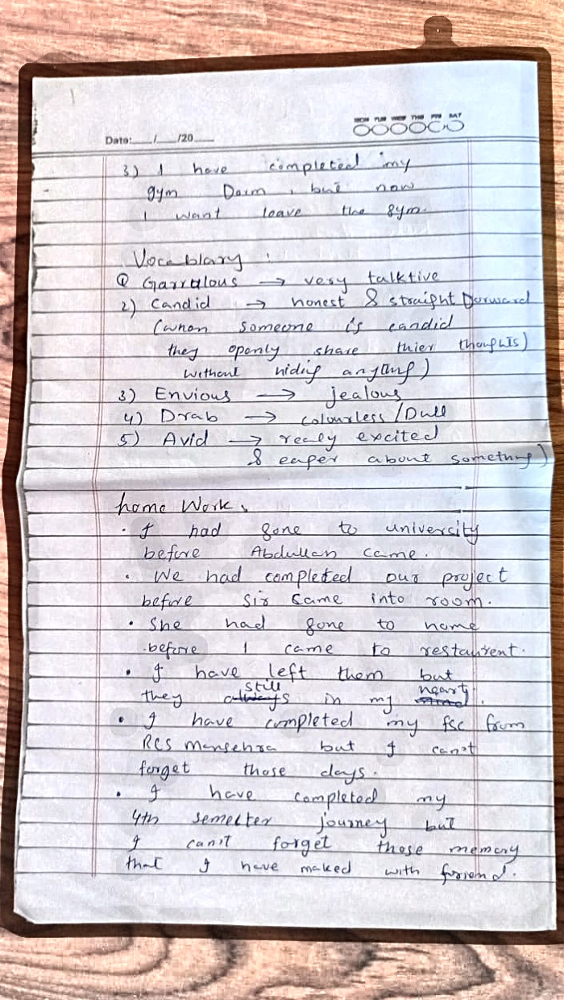
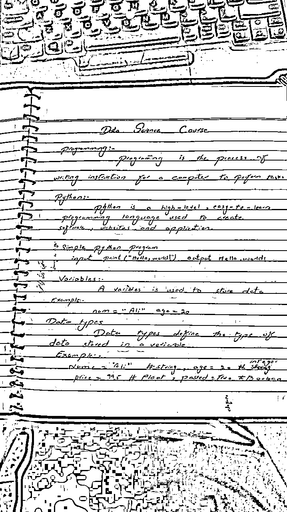
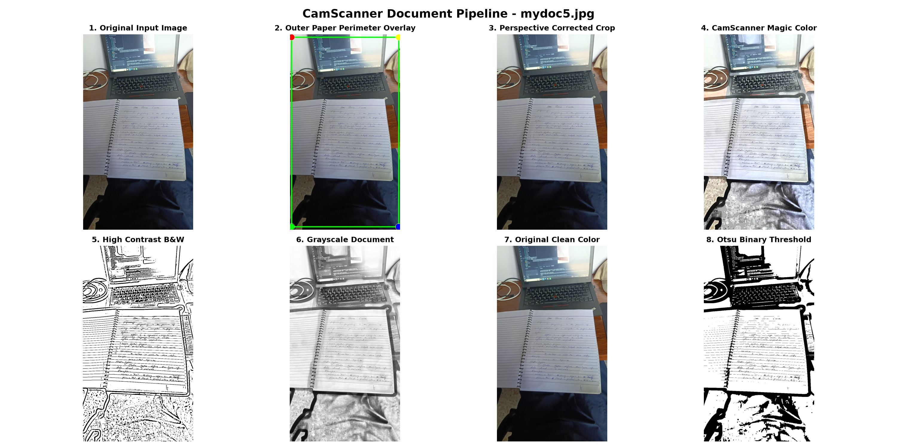
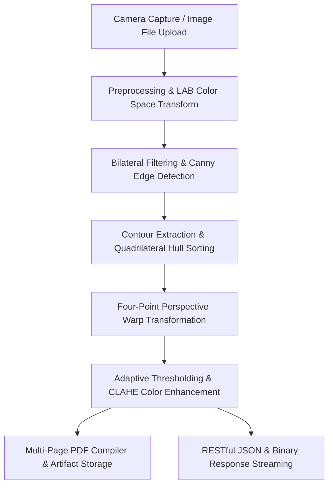

<div align="center">

<h1>Document Scanner Pro Studio</h1>


<p><strong>Enterprise-Grade On-Premise Computer Vision Document Digitization Engine</strong></p>

<p>
  <a href="https://skillicons.dev"></a>
</p>

</div>

---

## Executive Summary

Document Scanner Pro Studio is an on-premise computer vision application engineered to digitize physical documents with mathematical precision. Built using classical computer vision algorithms (OpenCV, NumPy) rather than remote cloud APIs, the system provides complete on-device data privacy, low-latency processing, and deterministic image transformations.

The processing pipeline applies LAB color space transformations, Canny edge detection, adaptive Gaussian thresholding, and affine perspective warps to detect document perimeters, rectify geometric skew, and produce publication-ready binarized scans.

---

## Application Interface & Visual Output Gallery

<table align="center">
  <tr>
    <td align="center"><b>Dashboard & Document Ingestion</b><br><sub>Responsive interface for uploading high-resolution camera frames.</sub></td>
    <td align="center"><b>Interactive Quad Corner Warping</b><br><sub>Real-time spatial mapping and manual quadrilateral corner adjustment.</sub></td>
  </tr>
  <tr>
    <td align="center"></td>
    <td align="center"></td>
  </tr>
  <tr>
    <td align="center"><b>Magic Color 2.0 Whitening</b><br><sub>Removes uneven ambient illumination while preserving ink density.</sub></td>
    <td align="center"><b>B&W High-Contrast (OCR-Ready)</b><br><sub>Adaptive Gaussian thresholding optimized for text extraction.</sub></td>
  </tr>
  <tr>
    <td align="center"></td>
    <td align="center"></td>
  </tr>
  <tr>
    <td align="center"><b>Scan History & Batch Operations</b><br><sub>Historical document catalog with multi-page PDF compilation.</sub></td>
    <td align="center"><b>Multi-Filter Diagnostic Grid</b><br><sub>Side-by-side comparative evaluation of enhancement modes.</sub></td>
  </tr>
  <tr>
    <td align="center"></td>
    <td align="center"></td>
  </tr>
</table>

---

## System Architecture



---

## Core Engineering Capabilities

### Algorithmic Computer Vision Pipeline
- **Four-Tier Perimeter Detector**: Multi-stage detection combining morphological gradient filtering, Canny edge detection, and convex hull area evaluation to isolate document boundaries under skewed lighting.
- **Perspective Rectification**: Automated four-point homography and affine warp mapping skew angles into standardized orthogonal document matrices.
- **Interactive Spatial Coordinate Mapping**: Frontend HTML5 Canvas enables precise corner adjustment, passing normalized coordinate vectors to the FastAPI image processor.

### Enhancement Presets
- **Mathematical Enhancement Modes**: Includes Magic Color Whitening, High-Contrast Binarization, Otsu Global Thresholding, and Adaptive Gaussian Binarization.
- **Image Parameter Controls**: Parametric controls over Exposure, Contrast Limited Adaptive Histogram Equalization (CLAHE), and Unsharp Mask text enhancement.

---

## Repository Structure

```
document-scanner-project/
|-- app.py
|-- scanner.py
|-- requirements.txt
|-- dataset/
|   |-- history.json
|   |-- input_images/
|   +-- output_images/
|-- screenshot/
|   |-- Screenshot 2026-08-05 150313.png
|   |-- Screenshot 2026-08-05 150447.png
|   +-- Screenshot 2026-08-05 150506.png
|-- static/
|-- tests/
+-- utils/
    |-- detection.py
    |-- enhancement.py
    |-- helper.py
    +-- preprocessing.py
```

---

## Technology Stack

| Layer | Technologies |
| :--- | :--- |
| Core Language | Python 3.10+ |
| Computer Vision & Math | OpenCV, NumPy, Pillow, Scipy |
| API Framework | FastAPI, Uvicorn, Pydantic |
| Document Output | FPDF2, PyMuPDF |
| Frontend Interface | Vanilla JavaScript, Tailwind CSS |

---

## Installation & Setup

```bash
# Clone the repository
git clone https://github.com/sohailahmed-bsrh/document-scanner-project.git
cd document-scanner-project

# Configure environment
python -m venv venv
venv\Scripts\activate

# Install dependencies
pip install -r requirements.txt

# Start the vision server
python app.py
```
Access the application at `http://127.0.0.1:8000`.

---

## Author & License

- **Author**: Sohail Ahmed ([Portfolio](https://sohail.devsil.com) | [GitHub](https://github.com/sohailahmed-bsrh))
- **License**: Distributed under the MIT License.
