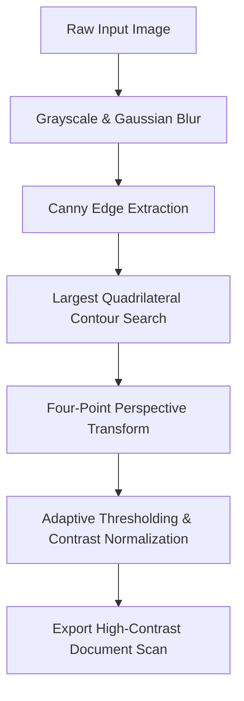

# Automated Document Scanner and Perspective Correction Engine

> Geometric computer vision pipeline that rectifies angled camera captures into planar document scans.

[](https://github.com/sohailahmed-bsrh/document-scanner-project)
[](https://sohail.devsil.com/projects.html)
[](https://sohail.devsil.com)

---

## Overview

Mobile photographs of printed documents suffer from non-uniform perspective distortion, uneven lighting, and background noise that degrade OCR accuracy.

This project provides an end-to-end, reproducible implementation engineered to solve this challenge through verified data transformations, robust algorithms, and production-ready architecture.

---

## Key Features

- Edge detection pipeline combining Gaussian smoothing, adaptive thresholding, and Canny filter
- Automatic four-point polygon contour detection identifying document corners
- Planar homography transformation mapping perspective distortion to a standardized 2D plane
- Interactive comparison slider interface in React/TypeScript frontend

---

## System Architecture



---

## Technology Stack

| Technology | Version / Spec | Role in Architecture |
| :--- | :--- | :--- |
| **OpenCV** | `4.8+` | Edge extraction, contour hierarchy calculation, and warpPerspective |
| **Python** | `3.10+` | Image processing algorithms and backend API service |
| **React & TypeScript** | `18.2+` | Interactive web frontend with dynamic comparison slider |

---

## Repository Structure

```text
document-scanner-project/
|-- Documents-Scanner/
|   |-- app.py
|   |-- frontend/
|   |   |-- src/
|   |   `-- package.json
|-- src/
|-- .gitignore
|-- requirements.txt
`-- README.md
```

---

## Installation and Execution

### Prerequisites
- Python 3.10 or higher
- Git version control
- Virtual environment manager (`venv`)

### Setup Instructions
1. Clone the repository:
```bash
git clone https://github.com/sohailahmed-bsrh/document-scanner-project.git
cd document-scanner-project
```

2. Configure environment and dependencies:
```bash
python -m venv venv
source venv/bin/activate  # On Windows: venv\Scripts\activate
pip install -r requirements.txt
python Documents-Scanner/app.py
```

---

## Interface and Verification
The system produces verifiable execution logs, prediction matrices, or interactive browser interfaces depending on the target mode. Verify operation by executing the commands specified above or inspecting the demonstration notebooks.

---

## Author and Contact
Developed by **Sohail Ahmed** — Full Stack AI Engineer & Machine Learning Specialist.
- **Portfolio:** [sohail.devsil.com](https://sohail.devsil.com)
- **GitHub:** [@sohailahmed-bsrh](https://github.com/sohailahmed-bsrh)
- **Email:** [sohail.bsrh@gmail.com](mailto:sohail.bsrh@gmail.com)
