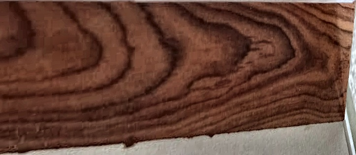
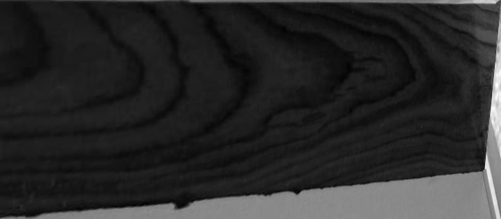
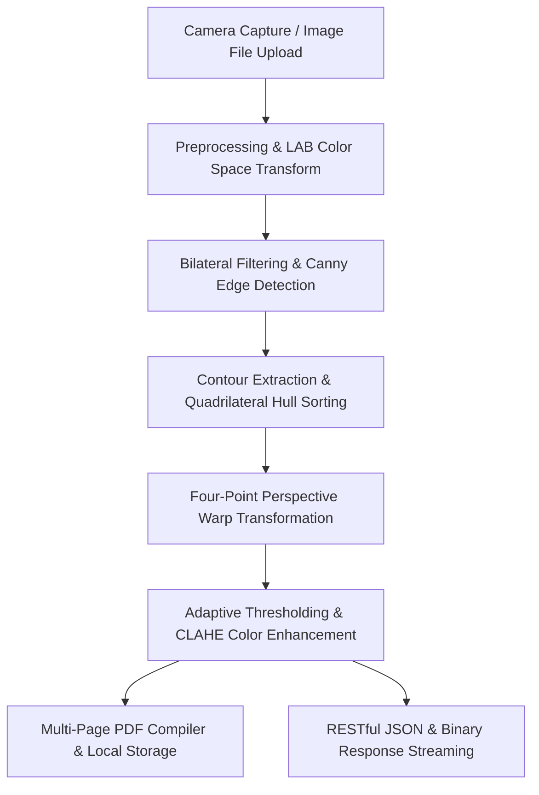

<div align="center">

<h1>Document Scanner Pro Studio</h1>


<p><strong>Enterprise-Grade On-Premise Computer Vision Document Digitization Engine</strong></p>

<p>
  <a href="https://skillicons.dev"></a>
</p>

<p>
  <a href="#overview">Overview</a> &bull;
  <a href="#system-architecture">Architecture</a> &bull;
  <a href="#visual-showcase-gallery">Visual Gallery</a> &bull;
  <a href="#core-capabilities">Capabilities</a> &bull;
  <a href="#installation--setup">Installation</a> &bull;
  <a href="#author--contact-information">Author</a>
</p>

</div>

---
## Overview

Document Scanner Pro Studio is an on-premise computer vision application engineered to digitize physical documents with mathematical precision. Built using classical computer vision algorithms (OpenCV, NumPy) rather than remote cloud APIs, the system provides complete on-device data privacy, low-latency processing, and deterministic image transformations.

The processing pipeline applies LAB color space transformations, Canny edge detection, adaptive Gaussian thresholding, and affine perspective warps to detect document perimeters, rectify geometric skew, and produce publication-ready binarized scans.

---

## Visual Showcase Gallery

### Application Interface & Interaction
<table width="100%" align="center">
  <tr>
    <td width="50%" align="center"><b>Dashboard & Ingestion Zone</b><br><sub>Document file selection and high-resolution camera intake.</sub></td>
    <td width="50%" align="center"><b>Interactive Quad Corner Warping</b><br><sub>Real-time spatial mapping with manual corner coordinates.</sub></td>
  </tr>
  <tr>
    <td align="center"></td>
    <td align="center"></td>
  </tr>
  <tr>
    <td width="50%" align="center"><b>Scan History & Batch Operations</b><br><sub>Persistent history catalog with multi-page compilation.</sub></td>
    <td width="50%" align="center"><b>Document Preview & Zoom Canvas</b><br><sub>High-resolution raster inspection of digitized documents.</sub></td>
  </tr>
  <tr>
    <td align="center"></td>
    <td align="center"></td>
  </tr>
  <tr>
    <td width="50%" align="center"><b>Algorithmic Filter Controls</b><br><sub>Parametric adjustments for contrast, exposure, and sharpness.</sub></td>
    <td width="50%" align="center"><b>PDF Batch Export Configuration</b><br><sub>Page order arrangement and PDF compilation settings.</sub></td>
  </tr>
  <tr>
    <td align="center"></td>
    <td align="center"></td>
  </tr>
  <tr>
    <td colspan="2" align="center"><b>Export Confirmation & File Download Modal</b><br><sub>Instant high-fidelity download of transformed documents.</sub></td>
  </tr>
  <tr>
    <td colspan="2" align="center"></td>
  </tr>
</table>

### Image Enhancement Output Benchmarks
<table width="100%" align="center">
  <tr>
    <td width="50%" align="center"><b>Magic Color 2.0 Whitening</b><br><sub>Background illumination correction preserving ink integrity.</sub></td>
    <td width="50%" align="center"><b>High-Contrast B&W (OCR-Ready)</b><br><sub>Adaptive Gaussian thresholding optimized for downstream text extraction.</sub></td>
  </tr>
  <tr>
    <td align="center"></td>
    <td align="center"></td>
  </tr>
  <tr>
    <td width="50%" align="center"><b>Clean Original Rectification</b><br><sub>Perspective warp without destructive color remapping.</sub></td>
    <td width="50%" align="center"><b>Grayscale Normalization</b><br><sub>Single-channel luminosity mapping for document archiving.</sub></td>
  </tr>
  <tr>
    <td align="center"></td>
    <td align="center"></td>
  </tr>
  <tr>
    <td colspan="2" align="center"><b>Multi-Filter Diagnostic Grid</b><br><sub>Direct comparative matrix of all algorithmic enhancement modes.</sub></td>
  </tr>
  <tr>
    <td colspan="2" align="center"></td>
  </tr>
</table>

---

## System Architecture



---

## Core Capabilities

- **Four-Tier Perimeter Detector**: Multi-stage detection combining morphological gradient filtering, Canny edge detection, and convex hull area evaluation to isolate document boundaries under skewed lighting.
- **Perspective Rectification**: Automated four-point homography and affine warp mapping skew angles into standardized orthogonal document matrices.
- **Interactive Spatial Coordinate Mapping**: Frontend HTML5 Canvas enables precise corner adjustment, passing normalized coordinate vectors to the FastAPI image processor.
- **Mathematical Enhancement Modes**: Includes Magic Color Whitening, High-Contrast Binarization, Otsu Global Thresholding, and Adaptive Gaussian Binarization.

---

## Technology Stack

| Layer | Technologies |
| :--- | :--- |
| Core Language | Python 3.10+ |
| Computer Vision & Math | OpenCV, NumPy, Pillow, Scipy |
| API Framework | FastAPI, Uvicorn, Pydantic |
| Document Output | FPDF2, PyMuPDF |
| Frontend Interface | Vanilla JavaScript, Tailwind CSS |

---

## Installation & Setup

```bash
# Clone the repository
git clone https://github.com/sohailahmed-bsrh/document-scanner-project.git
cd document-scanner-project

# Configure environment
python -m venv venv
venv\Scripts\activate

# Install dependencies
pip install -r requirements.txt

# Start the vision server
python app.py
```
Open `http://127.0.0.1:8000` in your web browser.
---

## Author & Contact Information

<table width="100%">
  <tr>
    <td width="150" align="center" valign="middle">
      
    </td>
    <td>
      <h3>Sohail Ahmed</h3>
      <p><strong>Senior Software Engineer & AI Systems Architect</strong></p>
      <p>Specializing in Full-Stack AI Application Development, Computer Vision, Deep Learning Pipelines, and Scalable Automation Architectures.</p>
      <p>
        <a href="https://sohail.devsil.com"><strong>Portfolio Website</strong></a> | 
        <a href="https://github.com/sohailahmed-bsrh"><strong>GitHub Profile</strong></a> | 
        <a href="https://www.linkedin.com/in/sohail-ahmed-devsil/"><strong>LinkedIn</strong></a> | 
        <a href="https://www.kaggle.com/sohail2411126"><strong>Kaggle</strong></a> | 
        <a href="https://x.com/ahmed241126"><strong>Twitter/X</strong></a> | 
        <a href="mailto:se906403@gmail.com"><strong>Email Contact</strong></a>
      </p>
    </td>
  </tr>
</table>
